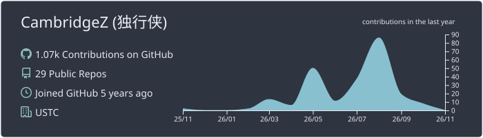
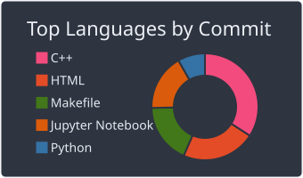
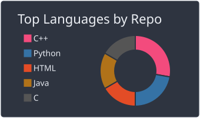

  

  <h1>Hi, I'm CambridgeZ 👋</h1>

  
<strong>Software engineering · Open source · Always learning</strong>

  

    <a href="https://www.cambridgez.xyz/">Personal website</a>
    &nbsp; · &nbsp;
    <a href="#about-me">About me</a>
    &nbsp; · &nbsp;
    <a href="#toolbox">Toolbox</a>
    &nbsp; · &nbsp;
    <a href="#github-activity">GitHub activity</a>
  

## About me

- 🎓 Pursuing a degree in **Software Engineering** at [USTC](https://www.ustc.edu.cn/).
- 👨‍💻 Software Engineer Intern at [Microsoft](https://www.microsoft.com/).
- 🌱 Learning, building, and working toward contributing to [open source](https://github.com/CambridgeZ).

## Toolbox

**Languages**

  

**Web &amp; backend**

  

**Tools &amp; platforms**

  

**Research &amp; writing**

  

## GitHub activity

  

### Top languages

  
  

## Connect with me

  <a href="https://www.cambridgez.xyz/">Personal website</a>
  &nbsp; · &nbsp;
  <a href="https://codeforces.com/profile/cambridgechao">Codeforces</a>
  &nbsp; · &nbsp;
  <a href="https://www.leetcode.cn/cambridgechao">LeetCode</a>

---

  Thanks for stopping by. Happy building!

